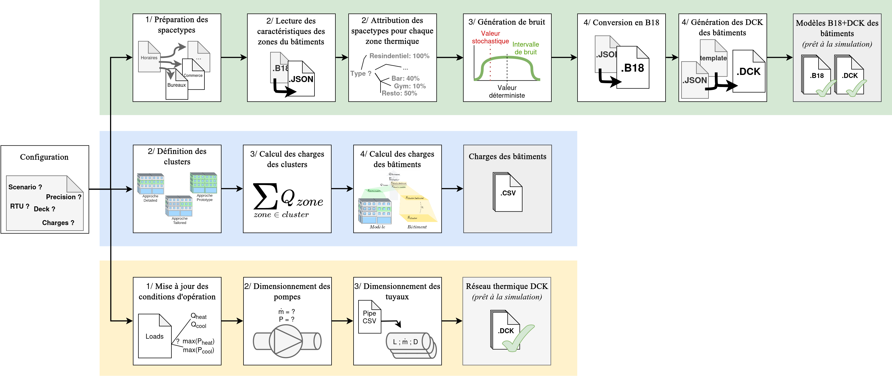

# TRNBpy

| Name        | TRNBpy       |
| ----------- | ------------ |
| Version     | 2.0          |
| Authors     | MEUNIER G., KUMMERT M. |
| Licence     | MIT          |
| Last update | October 2026 |
| Documentation | [Wiki](https://polymtl-bee.github.io/TRNBpy) |

> TRNBpy is a python tool for automatic attribution of constant, variable or stochastic occupancy hypothesis to complex TRNBUILD project. Building .B18 and .DCK files ready for simulation.

## Algorithm scheme 

As shown in below, the TRNBpy tool serves three distinct purposes:

1. First, simplify and automate the process of entering operational assumptions into building structural files. These are the green steps in the figure below. To do this, the user provides files describing the site’s geometry (currently in B18 format from SketchUp 3D) and a site description (CSV files containing various area measurements). The tool will then assign a spacetype to each thermal zone, according to predefined rules. The data is formatted in JSON before being converted to B18 and DCK formats to enable simulation with TRNSYS18.
2. Second, scale the model requirements to match the actual building requirements. These are the blue steps in the figure below. To do this, three similar algorithms enable scaling for each of the three methods: *Detailed*, *Archetype*, and *Prototype*. These algorithms perform the scaling by intelligently and appropriately grouping a certain number of thermal zones, which we call *clusters*. We can calculate the requirements for each cluster, the floor area of the clusters in the models, and the desired floor area of the clusters in the actual buildings. Finally, summing the cluster requirements and applying the ratio of building floor area to model floor area gives us the total requirements for each building.
3. Third, generate a DCK file to simulate a thermal network sized according to the input requirements. These are the yellow steps. To do this, a thermal network was modeled using the simplified and reduced approach. The TRNBpy tool simply rewrites the key sizing values based on the input data (requirements per cluster and pipe sizing, files generated by PipingTool).

## Example of use

See the documentation example of use [example of use](https://polymtl-bee.github.io/TRNBpy/example.html) for details.
