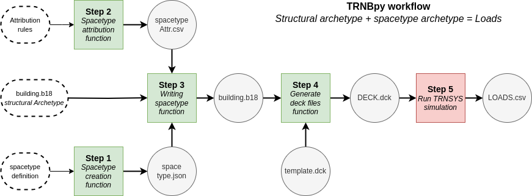
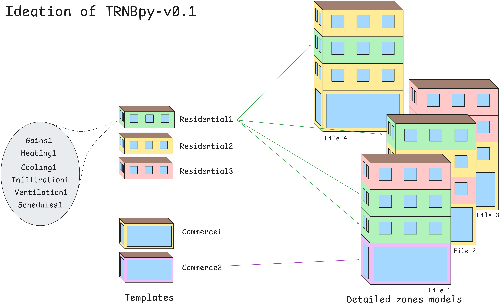

# TRNBpy

|Author|Version|Last update|
|-|-|-|
|Guilwen Meunier| v0.1 | 07/02/2026|

This tool is being developed by Guilwen Meunier for the needs of his master thesis to write spacetypes
("thermal zone occupation, gains, schedules, heat & cool equipement, ventilation, infiltration...") in the thermal zones of a 
TRNBUILD file (containing thermal zones geometry, surfaces properties and boundaries).

## Algorithm scheme 

## Ideation of use

