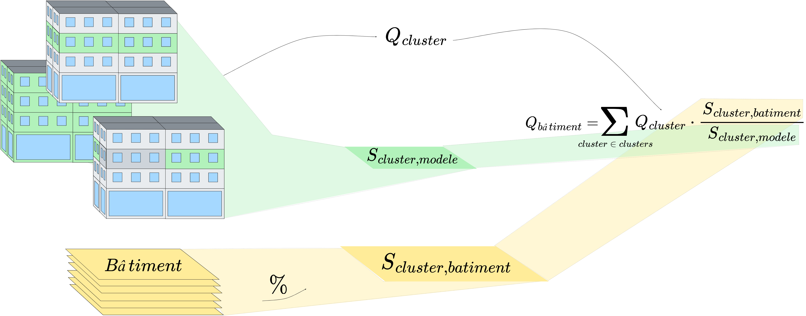

Documentation of TRNBpy Tool
============================

0. Configuration
-----------------

Configuration involves selecting the parameters. All paths and variables used
are listed in the config.y file. The main parameters that the user is
prompted to enter are:

- The relative path to the scenario file.
- The level of precision for buildings *Precision_BLD* in the three
  methods studied in this research (*Detailed*, *Tailored*,
  *Prototype*).
- The level of precision for the operational assumptions
  *Precision_EXP*, which determines whether variability and noise should
  be added.
- The level of precision for the district heating network
  *Precision_THN*, which defines the topology and load groupings within
  the district heating network (and thus specifies which subfolder
  generated by PipingTool to use).

1. Model Generation
-------------------

Model generation (green path) is broken down into several steps. Their
roles are detailed below.

1.1 Preparing Spacetypes
~~~~~~~~~~~~~~~~~~~~~~~~

The first step is to prepare the schedules. For each spacetype, the
annual schedules are stored in a CSV file. It is easier for humans to
write daily schedules than schedules broken down into one-hour time
steps. That is why TRNBpy includes a function to generate annual
schedules from daily schedules provided as input in a CSV file (for
weekdays, Saturdays, and Sundays, for each desired profile). We use
these annual schedules as inputs for the B18 model because this allows
for a more flexible definition (to add vacations and holidays, for
example). The associated functions can be found in
``_SiteDataBuilder.py``.

1.2 Generating JSON Files for Buildings
~~~~~~~~~~~~~~~~~~~~~~~~~~~~~~~~~~~~~~~

In this section, we proceed in several steps. These steps can be found
in ``_jsonbuilder.py``.

1. First, we generate a data structure in JSON format, listing each zone
   in a building along with its main properties (ID, name, area, volume,
   exterior surface area, floor, etc.). These characteristics are
   extracted from the building’s B18 file. In the future, when TRNSYS
   natively supports JSON files for its buildings, this step can be
   omitted.
2. Next, we assign a spacetype to each thermal zone. There are two
   methods for doing this. The first method is “manual,” where each type
   of thermal zone corresponds to a single spacetype. The second method
   is “conditional,” where each type of thermal zone corresponds to a
   set of spacetypes and their average representation. For example:
   ``{“Restaurant”: 0.2; ‘Retail’: 0.6; “Theater”: 0.2}``. The sum must
   equal 1, and the representation corresponds to the desired percentage
   of the spacetype’s area relative to the building’s total area. The
   spacetype assigned to each thermal zone is then stored in the zone’s
   properties within the building’s JSON file. This “conditional” method
   allows for the distribution of different commercial zones and, in
   certain scenarios, introduces variability into residential spaces.
3. Third, for each zone, if the assigned spacetype includes certain
   gains, ventilation, or infiltration whose values depend on the zone’s
   geometric characteristics, then the values of these objects are
   recalculated. For example, the value of the lighting gain for a
   thermal zone depends on the zone’s floor area. Thus, once the
   spacetype has been assigned and stored in a zone’s characteristics,
   we can update the lighting gain since we know the zone’s floor area.

1.3 Noise Generation
~~~~~~~~~~~~~~~~~~~~

Noise generation function are in the ``NoiseBuilder.py`` file.
Finally, if the scenario is configured to have variable occupancy
assumptions, functions to add noise are called in order to vary the
values of certain gains and schedules. The buildings’ JSON files are
thus read, edited, and saved. Noise is introduced for internal heat
gains, DHW, and ventilation using a random selection algorithm within a
specified range, while ensuring that the sum (or rather the average) of
the values for each object remains constant. Introducing noise into the
schedules involves reading the annual schedule file, identifying
transition periods (for example, when the heating setpoint changes from
18°C to 24°C at 8:00 a.m.), and then shifting these transition periods
within a fixed interval (for example, the heating setpoint changes from
18°C to 24°C randomly between 6 a.m. and 10 a.m.). Thus, for each
schedule and for each transition period, the developed algorithm
randomly selects a time within the fixed interval. The values are then
adjusted to shift the transition to the randomly selected time.

1.4 Conversion to the B18 Format
~~~~~~~~~~~~~~~~~~~~~~~~~~~~~~~~

Based on our discussions with TRNSOLAR, it appears that TRNSYS19 is
moving toward a more text-based data structure using the JSON format.
This is the basis for our development decision. However, for the time
being, TRNSYS18 uses the text-based .B18 format for building files. This
is why we need to convert the main building files so that they can be
interpreted by the software as of today. To this end, the building input
files (also in .B18 format, since the SketchUp3D extension is intended
for TRNSYS18) are updated using writing functions to add the inputs,
outputs, gains, ventilation, infiltration, schedules, etc., specific to
each thermal zone of the building. These conversion functions can be
found in ``_TranslateToB18.py``.

1.5 DCK Generation
~~~~~~~~~~~~~~~~~~

In this section, the tool’s objective is to generate a DCK file that
links a .B18 building file with the CSV file containing its input
schedules, the desired weather file, and the building’s output boxes in
order to generate the desired output CSV files. Several functions are
used for this purpose in the ``deckbuilder.py`` file.

2. Calculation of Building Loads
--------------------------------

The calculation of building loads uses the ``Load builder`` file. 
It follows the same model for all three building modeling approaches. First, identify groups of thermal zones
(i.e., *clusters*); next, calculate the loads for these *clusters*; and
finally, determine the building loads based on the respective areas of
the clusters in the desired models and buildings.

   ScalingMethods

2.1 Definition of Clusters
~~~~~~~~~~~~~~~~~~~~~~~~~~

The definition of thermal zone groupings depends entirely on the chosen
modeling approach. First, note that for each building, we associate one
or more models to be used for calculating loads, and that this
association guides the definition of *clusters*.

- For the *detailed* approach, the geometry of the models accurately
  reflects that of the buildings. Thus, a single model is associated
  with each building; for example, the loads on the ground floor of a
  model correspond to the loads on the ground floor of the modeled
  building. The only exception is that the central floors are reduced to
  a single central floor in the models. For each building, the grouping
  by thermal zone accounts for this by defining each cluster as the set
  of zones on the same floor.
- For the *reference-based* approach, the geometry is simplified and
  does not directly represent the buildings. However, each building has
  been assigned a single model that includes at least all of the
  building’s uses. Here, scaling must ensure that the proportions of
  each use are maintained. For each building, this involves defining a
  *cluster* as the set of zones on the same floor and of the same
  spacetype.
- For the *prototype* approach, in keeping with the inspiration from the
  DOE database, we consider that each model corresponds to a single
  spacetype. Here, each building has been assigned as many models as it
  has different uses. Thus, we define *clusters* for this approach as
  the set of zones with the same use. In terms of models, this
  corresponds to all zones within a single model.

2.2 Calculating Cluster Loads
~~~~~~~~~~~~~~~~~~~~~~~~~~~~~

Once these groupings have been identified, calculating their load is
fairly straightforward. In the models, we sum the loads of each of the
thermal zones that make up the *cluster*. Since the building’s JSON file
has been populated with the name of each zone’s cluster, a single
function is sufficient to perform the calculation.

2.3 Calculating Building Loads
~~~~~~~~~~~~~~~~~~~~~~~~~~~~~~

Two intermediate steps must be performed before the building loads can
be calculated. First, calculate the area of the cluster in the models
using the models’ JSON file. Next, calculate the area of each cluster in
the desired buildings using the CSV file describing the buildings. Once
these steps are completed, the loads for a building are given by
:math:`Q_{building}=\displaystyle\sum_{c \in C_{building}}Q_c \cdot \frac{S_{c,model}}{S_{c,building}}`.
Where :math:`C_b` is the set of clusters in a building, :math:`Q_c` is
the load of cluster :math:`c`, :math:`S_{c,model}` is the area of the
cluster in the models, and :math:`S_{c,building}` is the area of the
cluster in the buildings. The area calculations are performed
independently for the three building modeling approaches.

3. Generation of the Heating Network
------------------------------------

Generating the heating network essentially involves reading and updating
certain values in a pre-built heating network file. These *template*
files are based on previous work carried out during a feasibility study
for the city of Laval, in which I was tasked with building a heating
network model using TRNSYS. These steps use building loads and pipe
sizing files from PipingTool as inputs. The model is updated in three
areas: equipment operating conditions, pump sizing, and pipe sizing.

3.1 Updating Operating Conditions
~~~~~~~~~~~~~~~~~~~~~~~~~~~~~~~~~

Based on peak and annual values for heating and cooling loads, we can
redefine the nominal values for the heat pump’s condenser and
evaporator, as well as the nominal value for the chiller. We can also
update the performance correction factors for the heat pump and the
chiller if the system’s operating temperatures change.

3.2.Updating Pumps
~~~~~~~~~~~~~~~~~~

For each pump, we can update the maximum flow rate and the maximum loads
passing through the pump pipe, thereby defining the pump’s rated power
and duty factor at all times.

3.3 Updating Pipes
~~~~~~~~~~~~~~~~~~

For each pipe, we update its length, inner and outer diameters, and the
thickness of the insulation. By default, we also redefine the thermal
conductivity of the insulation and the pipe (which are considered
constant in our models).

