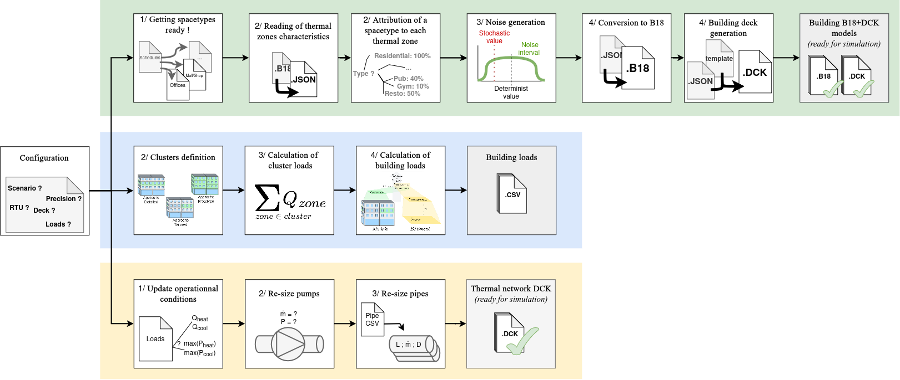

.. TRNBpy documentation master file, created by
   sphinx-quickstart on Thu Sep 24 12:12:33 2026.
   You can adapt this file completely to your liking, but it should at least
   contain the root `toctree` directive.

Documentation of TRNBpy Tool
============================

=========== ===============
Name        TRNBpy
=========== ===============
Version     2.0
Licence     MIT
Author      MEUNIER Guilwen
Last update October 2026
=========== ===============

Overview of TRNBpy
------------------

As shown in following figure, the TRNBpy tool serves three distinct
purposes:

1. First, to simplify and automate the entry of operational assumptions
   into building structural files (green path). At the end of these
   steps, TRNBpy will generate building files in JSON and B18 formats,
   as well as the necessary decks (DCK) to run simulations using
   TRNEdit.
2. Second, to scale the model loads to the building loads (blue path).
   To do this, three similar algorithms enable scaling for each of the
   three methods: *Detailed*, *Tailored*, and *Prototype*.
3. Third, to generate a deck file to simulate a heating and cooling
   system sized according to the input loads (yellow path).

Table of contents
-----------------

.. toctree::
   :maxdepth: 2
   :caption: Contents:
   
   documentation.rst
   example.rst
   codedoc.rst
   licence.rst
